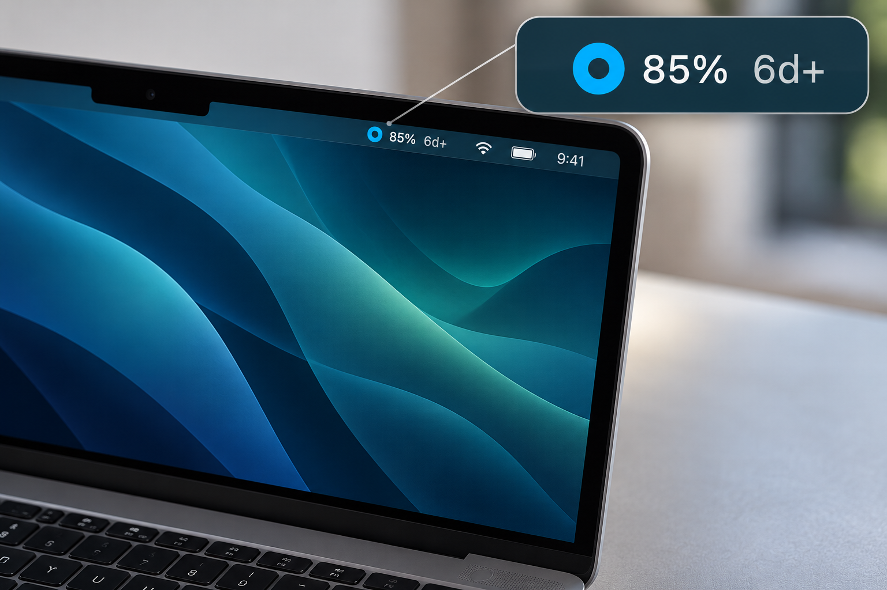
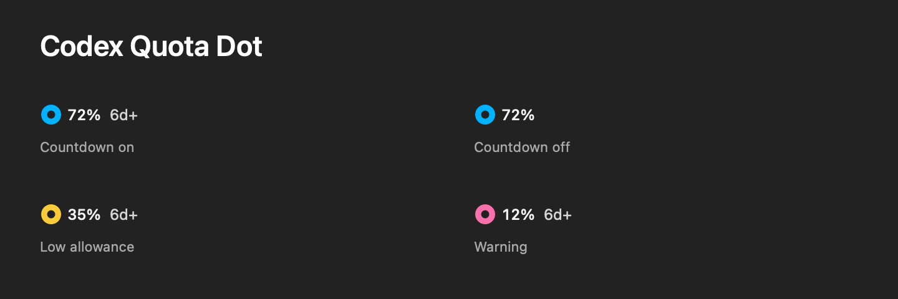

# Codex Quota Dot · 原生极简，安静好用

**Native, minimal, quiet — Codex quota in your Mac menu bar.**

Codex 剩余额度，抬眼就知道。一个圆环、剩余额度，以及可选的重置倒计时。把必要的信息留在菜单栏，让查看额度成为一件简单、安静的小事。

Your remaining Codex quota, at a glance. A dot, a percentage, and an optional reset countdown. Just the essentials, quietly at home in your Mac menu bar.

本项目是非官方工具，与 OpenAI 无隶属或背书关系。

An unofficial tool, not affiliated with or endorsed by OpenAI.



MacBook 场景渲染图：参考实际菜单栏样式制作，局部放大展示；额度和倒计时仅作示例。

MacBook scene render based on the implemented menu-bar design, with an enlarged detail. Quota and countdown values are illustrative.

## 少而精，刚刚好 / Less, done well

- **原生质感 / Native by design.** 使用 Swift + AppKit 构建，采用 macOS 原生菜单栏和菜单交互，自然融入你的 Mac。 Built with Swift and AppKit, using native macOS menu-bar and menu interactions to feel right at home.
- **简洁耐看 / Refined simplicity.** 围绕查看额度，只保留必要功能。圆环、百分比和可选倒计时，清楚、克制、刚刚好。 A clear, considered display with only the essentials: a dot, your remaining percentage, and a countdown you can show or hide.
- **安静好用 / Quietly useful.** 后台自动刷新，没有 Dock 图标、常驻主窗口、通知或提示音。需要时看一眼，其余时间安心专注。 Refreshes in the background, with no Dock icon, main window, notifications, or sounds. There when you need it, quiet while you work.



示例使用模拟数值，仅展示界面样式，不代表实时账户额度。

These examples use simulated values to demonstrate the interface, not live account data.

## Features / 功能

圆环由原生矢量几何绘制，保持完整圆形，内外径比例为 **52:128**。颜色表示**剩余额度档位**，圆环长度不表示进度。百分比向下取整。

| 剩余额度 | 颜色 |
|---|---|
| 大于 50% | 蓝色 `#00B2FF` |
| 20% 至 50%，含边界 | 黄色 `#FFCC39` |
| 低于 20% | 粉红色 `#FA70AC` |
| 暂无有效数据 | 灰色 |

倒计时按所显示额度窗口的重置时间计算：整 5 天显示 `5d`，5 天多显示 `5d+`；不足一天按整小时向下显示，例如 8 小时 40 分显示 `8h`；不足一小时显示 `<1h`。

点击菜单栏即可查看各额度窗口、完整重置时间和更新时间，也可以：

- 使用“显示重置倒计时”开关。默认开启，选择在重新启动后保留；隐藏倒计时后，菜单仍显示完整重置时间。
- 立即刷新额度。
- 手动开启或关闭“开机自动启动”。首次运行不会自动注册登录项；系统要求批准时，可从菜单打开登录项设置。
- 退出应用。

## Requirements / 环境

- macOS 13 或更高版本。
- Swift 5.9 或更高版本，可通过 Apple Command Line Tools 或 Xcode 提供。
- 本机已安装官方 Codex CLI，并已通过官方客户端使用 ChatGPT 账户登录。

无额外 Swift 包依赖。No third-party Swift packages.

目前只在 **Apple Silicon / macOS 26** 上测试过。最低系统版本是构建目标，不代表已经覆盖所有系统与处理器；Intel 兼容性尚未验证。默认构建当前机器架构。

## Build & run / 构建与运行

克隆项目并构建：

```sh
git clone https://github.com/angeV587/codex-quota-dot.git
cd codex-quota-dot
./test.sh
zsh build.sh
```

将生成的 `dist/CodexQuota.app` 拖入 Applications（应用程序）后打开。更新时先退出旧应用，再替换完整应用包。

当前仅分享源码。构建产物使用本机 **ad-hoc 签名，未经 Apple 公证**；它不是已经完成 Developer ID 签名与公证的公开发行安装包。

## Data & refresh / 数据与刷新

工具调用本机官方 Codex CLI 的 `app-server`，使用 `account/read` 和 `account/rateLimits/read` 查询既有登录账户的额度。应用本身不读取凭据文件、不使用浏览器 cookie、不保存 token、不请求 API key，也不进行模型推理或修改 Codex 配置。

只读取 `codex` 额度桶。存在多个窗口时，菜单栏采用**剩余额度最低的窗口**，菜单展示全部窗口。API token 用量、上下文长度和其他 ChatGPT 独立额度不计入此处。

- 正常每 5 分钟查询一次；启动、账户读取与额度读取共用 40 秒总超时，查询结束后清理子进程。
- 失败后按 1、2、4、8、15 分钟退避重试。睡眠时停止查询，唤醒后刷新。
- 最近 15 分钟内仍有效的缓存可在暂时失败时显示，百分比后加 `*` 表示旧数据；超过 15 分钟或额度窗口已重置后，改为 `--%`，不会把未知额度显示为 100%。
- 倒计时每分钟在本地更新，不因此增加额度查询请求。缺少有效重置时间时显示 `--`。

数据可用性取决于本机 Codex 登录状态及官方 `app-server` 协议支持。

## License / 许可

本项目采用 [MIT License](LICENSE) 发布。OpenAI、Codex 等名称属于各自权利人。

## References / 官方资料

- [Codex app-server](https://developers.openai.com/codex/app-server/)
- [Apple NSStatusItem](https://developer.apple.com/documentation/appkit/nsstatusitem)
- [Apple SMAppService](https://developer.apple.com/documentation/servicemanagement/smappservice)
- [Apple Developer ID 与分发](https://developer.apple.com/developer-id/)
